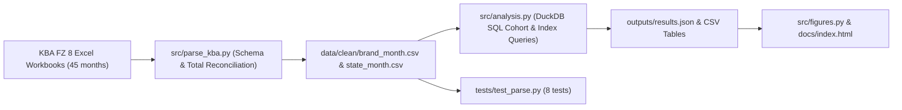

# Germany's Shift to Battery-Electric Cars (KBA 2023–2026)

Analysis of 45 months of official passenger-car registration data from the Kraftfahrt-Bundesamt (KBA, series FZ 8.2 by brand and FZ 8.6 by federal state, January 2023 to September 2026) to answer a strategy question for Munich automotive and mobility employers: **where does BMW Group stand as the German market shifts to battery-electric vehicles (BEVs), and who is winning share?**

## Measured Results (YTD Jan–Sep 2026 vs. Jan–Sep 2025)

- **Market recovery:** Total German new registrations rose from **2,110,348** to **2,221,798** (+5.3%), while battery-electric registrations rose from **382,202** (18.1% share) to **604,144** (27.2% share, +9.1 percentage points).
- **BMW Group out-indexes its weight:** BMW Group (BMW, MINI, Rolls-Royce) registered **63,819 BEVs** out of **222,346** total cars (28.7% internal BEV share vs. 21.8% a year earlier), holding **10.56% of Germany's BEV market** against **10.01% of the overall car market** (**BEV Index = 1.06**, the only legacy German OEM above 1.00; Volkswagen Group sits at 0.87 and Mercedes-Benz at 0.93).
- **Competitive pressure:** Volkswagen Group lost **9.98 percentage points** of German BEV market share year-on-year (44.34% to 34.36%), while BYD grew from negligible volume to **42,788 registrations** (16,355 BEVs and 26,432 PHEVs; BEV Index 1.41) and Hyundai-Kia reached a 38.9% internal BEV share (BEV Index 1.43).

## Architecture



## Verification (`pytest`)

`tests/test_parse.py` runs 8 tests before any chart or metric is trusted:
1. Brand rows add up exactly to KBA's own `INSGESAMT` line (total, BEV and PHEV) in the September 2026 file.
2. Known values from that file match KBA FZ 8.4 (BMW total, BEV and PHEV; national BEV count; Bavaria's BEV count).
3. Federal-state rows add up to the national total.
4. In every downloaded month (2023-01 to 2026-09), brand rows add up to the KBA total for all cars and for BEV.
5. Number parsing handles KBA's formats (`-`, thousands dots, empty cells, plain numbers): 4 cases.

## Reproduce

```bash
python src/parse_kba.py
python src/analysis.py
python src/figures.py
pytest -q
```

*Data source: Kraftfahrt-Bundesamt (KBA), FZ 8, Datenlizenz Deutschland – Namensnennung – Version 2.0.*
